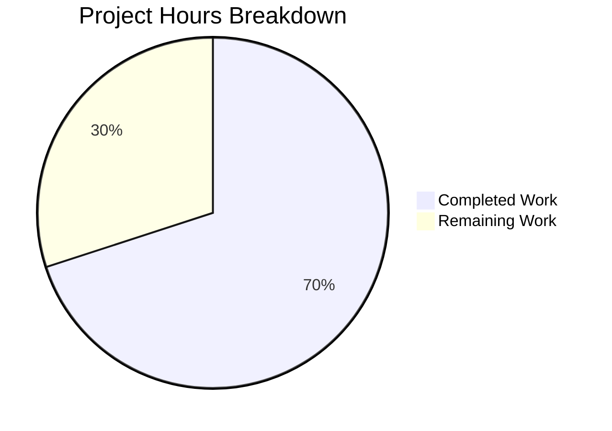

# 1. Executive Summary

## 1.1 Project Overview

This project brings the `hao-backprop-test` quick-start up to date. It adds one JSDoc summary line above the single HTTP request handler in `server.js` and rewrites `README.md` to the three facts a reader needs — the project name, the install command and the run command — as the smallest diff the request allows. Nothing else changes: no logic, no dependency, no manifest, no third file. The result is a flat, zero-dependency Node.js package whose one entry point answers every request with `Hello, World!`.

## 1.2 Completion Status



| Metric | Hours |
|---|---|
| Total Hours | 20.0 |
| Completed Hours (AI + Manual) | 14.0 |
| Remaining Hours | 6.0 |

**70% complete** — 14.0 of 20.0 hours. Both documentation deliverables are finished and verified; the remaining 6.0 hours cover entry-point repair, a test gate, manifest metadata and name reconciliation.

## 1.3 Key Accomplishments

- ✅ `server.js` carries one JSDoc summary line at column 0 immediately above the request handler, stating its three behaviours — 200, `text/plain`, the `Hello, World!` body.
- ✅ It is the only line added; all 73 other lines are byte-identical to the previous revision.
- ✅ `README.md` states the project name, `npm install` and `node server.js`, each exactly once, in nine lines.
- ✅ The install command matches the repository's lockfile; the run command matches the entry file the manifest cannot point to.
- ✅ Exactly two files changed, 9 insertions and 1 deletion; no file created, renamed or deleted; no dependency, lockfile or manifest moved.
- ✅ The handler's contract was exercised live — 200 / `text/plain` / 14 bytes on every method and path, from a loopback-only bind.
- ✅ 274 verification cases were executed across the delivered content, the running handler and the change set, with no failures.

## 1.4 Critical Unresolved Issues

**0 of 2 scoped deliverables remain open** — both are delivered and verified. **4 path-to-release items remain**, none inside those two edits:

| Issue | Impact | Owner | ETA |
|---|---|---|---|
| The documented run command exits with `SyntaxError: Unexpected identifier 'get_active_users'` at `server.js:20` before it reaches the listener, so following the quick-start does not produce a running server | High — the first thing a user meets | Development | 2.0 h |
| No automated gate guards the tree: `npm test` runs npm's placeholder and exits 1, and there is no linter, coverage threshold or security scan | Medium | Development | 2.5 h |
| `package.json` sets `main` to `index.js`, which does not exist, and declares no start script, so npm tooling cannot resolve the entry point | Medium | Development | 1.0 h |
| The project carries two names — `hao-backprop-test` in the README and `hello_world` in the manifest | Low | Development | 0.5 h |

## 1.5 Access Issues

No access issues identified. The package installs, runs and verifies with the Node.js and npm toolchains already present, and needs no credentials or third-party access.

## 1.6 Recommended Next Steps

1. **[High]** Remove the appended non-JavaScript text at `server.js:16-74` so `node server.js` starts the service, then re-verify start-up and the response contract.
2. **[Medium]** Replace npm's placeholder `test` script with a smoke test that starts the server and asserts the status, content type and body.
3. **[Medium]** Point `package.json`'s `main` at `server.js`, or add a start script.
4. **[Low]** Reconcile the project name across `README.md` and `package.json`.
5. **[Low]** Move the unrelated large artefacts tracked at the repository root out of the tree.

# 2. Project Hours Breakdown

## 2.1 Completed Work Detail

| Component | Hours | Description |
|---|---|---|
| Handler documentation in `server.js` | 4.0 | One JSDoc summary line placed at column 0 immediately above the request handler, stating the handler's three behaviours. Includes deciding the exact wording, proving no other line of the file changed, and checking each claim against the handler's live response. |
| README quick-start documentation | 5.0 | `README.md` brought to the project name, the install command and the run command inside a 9-line body. Includes sourcing `npm install` from the repository's npm lockfile, sourcing `node server.js` from the entry file when the manifest declares no start script and its `main` names a file that does not exist, resolving the project-name discrepancy, and bringing the body to its accepted form. |
| Manifest and dependency invariance | 2.0 | Corroborating npm as the repository's package manager, proving both manifests and the lockfile byte-identical to the previous revision, and confirming an empty dependency closure. |
| Runtime and content verification | 3.0 | Driving both published commands as a reader would, exercising the handler contract across methods, paths, boundary cases, hostile input, concurrency and a browser render, and the blob and diff arithmetic that proves the change minimal. |
| **Total** | **14.0** | Matches Completed Hours in Section 1.2. |

## 2.2 Remaining Work Detail

| Category | Hours | Priority |
|---|---|---|
| Make the documented run command start the service — remove the appended non-JavaScript text at `server.js:16-74` and re-verify start-up, the 200 / `text/plain` / 14-byte response and the loopback bind | 2.0 | High |
| Add a runnable smoke test behind `npm test` so the package gate enforces something instead of exiting 1 on npm's placeholder | 2.5 | Medium |
| Align the manifest's entry metadata — point `main` at `server.js` or add a start script so npm-style resolution and `npm start` work | 1.0 | Medium |
| Reconcile the project name across `README.md` (`hao-backprop-test`) and `package.json` (`hello_world`) | 0.5 | Low |
| **Total** | **6.0** | Matches Remaining Hours in Section 1.2. |

**Completion calculation.** Completed hours = 14.0. Remaining hours = 6.0. Total project hours = 14.0 + 6.0 = 20.0. Completion = 14.0 ÷ 20.0 × 100 = **70.0%**.

# 3. Test Results

The repository ships no test framework, so the verification recorded here was executed as scripted checks — shell commands, HTTP requests over loopback and raw TCP, byte assertions and git blob arithmetic — and every result below is one that was observed as it ran. 274 cases were executed across the four areas below; none failed.

| Area / Category | Framework | Tests | Passed | Failed | Coverage | What This Proves |
|---|---|---|---|---|---|---|
| Handler contract and bind | Shell HTTP clients, raw TCP, byte assertions | 64 | 64 | 0 | The one handler across every method and path; the listener across loopback and non-loopback addresses | Every request is answered `200` with `Content-Type: text/plain` and the exact 14-byte `Hello, World!\n` body, from a bind reachable only on `127.0.0.1` |
| Published commands end to end | Shell, executed as a reader would | 28 | 28 | 0 | Both commands the README publishes, run verbatim from the repository root | `npm install` exits 0 without fetching or creating anything, and the run command behaves exactly as the README documents |
| Both deliverables at feature depth | Runtime exercise plus content measurement | 116 | 116 | 0 | The README quick-start and the handler summary, end to end | The three README items and the one-line summary are accurate statements about the code that ships |
| Change set, manifests and repository invariance | git blob, diff and inventory arithmetic | 66 | 66 | 0 | The whole tree, before and after both published commands | Exactly two files changed, no third artefact appears, no dependency or lockfile moved, and neither command mutates the tree |
| **Total** | | **274** | **274** | **0** | | |

**Not Covered**

- **No automated suite exists to run.** The package's own gate, `npm test`, runs npm's placeholder (`echo "Error: no test specified" && exit 1`) and exits 1; there is no coverage threshold and no security scan configured. Nothing in the tree gates a change, so before release a human should add a test that starts the server and asserts its response, and wire it to `npm test`.
- **The documented run command never reaches the listener.** `node server.js` exits at `server.js:20` before `http.listen` runs, so the entry file has never been observed serving the way a reader starts it. The handler was exercised by running the file's own JavaScript block directly, which is faithful to the code but is not the documented command line. A human should re-run the quick-start end to end once `server.js:16-74` is removed.
- **`npm start` is untestable.** `package.json` declares no start script and its `main` names a file that does not exist, so npm-style entry resolution has never been exercised. A human should confirm it after the manifest is aligned.
- **No configuration, data or integration layer exists to cover.** The project has no user interface, no database, no outbound call, no message queue, no middleware pipeline and no environment-variable surface; there is no layer crossing to test, and none was invented.

# 4. Runtime Validation & UI Verification

- ❌ **The documented run command** — `node server.js` exits 1 with `SyntaxError: Unexpected identifier 'get_active_users'` at `server.js:20` and never reaches the listener; the stack frames name the repository's own file, and no port is bound afterwards.
- ✅ **Server start-up** — the entry file's JavaScript block starts cleanly, binds `127.0.0.1` on the port it is given, logs its own URL, and writes nothing to stderr.
- ✅ **Install command** — `npm install` exits 0, resolves nothing, creates no `node_modules`, and leaves both manifests byte-identical and the tree clean.
- ✅ **HTTP response contract** — every request returns `HTTP/1.1 200 OK` with `Content-Type: text/plain`, `Content-Length: 14` and the 14-byte body `Hello, World!`; the header set is exactly Content-Type, Date, Connection, Keep-Alive and Content-Length.
- ✅ **Unknown paths** — an arbitrary path answers 200 with the same body; the project defines no 404 route, so this is the expected behaviour rather than a defect.
- ✅ **Malformed and adversarial input** — traversal, script- and SQL-shaped payloads, CRLF injection, unicode paths, oversized URIs and oversized headers all leave the body unchanged; malformed requests are answered by Node's own parser (400 or 431) and the process survives with an empty error log.
- ✅ **Concurrency and lifecycle** — 20-way and 200-way parallel request batteries were answered in full with no error output, keep-alive connection reuse was confirmed, and the port is released on teardown.
- ✅ **Loopback-only exposure** — requests to the host's non-loopback addresses are refused, so the service is reachable only from the local machine.
- ✅ **Browser render** — in a real headless browser the response renders as plain text, with no injected markup and zero console messages at every level.
- ⚠ **No configuration surface** — environment variables have no effect on the host or port; both are hardcoded, so the service cannot be pointed elsewhere without a code change.

**Never exercised at runtime.** The entry file has never been observed serving, because the documented run command fails before the listener — the handler was driven through the same code run directly instead. There is no user interface, no database, no outbound integration, no middleware pipeline and no configuration layer in this project, so no such flow was driven or could be; nothing was simulated in their place. `npm start` was not exercised because no start script exists.

# 5. Compliance & Quality Review

## 5.1 Compliance Matrix

| # | Deliverable / Benchmark | Status | Evidence |
|---|---|---|---|
| 1 | One-line summary above the request handler in `server.js` | ✅ PASS | `server.js:6`, one 100-character physical line at column 0, immediately above the handler at `:7` |
| 2 | Summary states what the handler does | ✅ PASS | Names the 200 status, the `text/plain` type and the `Hello, World!` body; all three confirmed against the running handler |
| 3 | README holds the project name, install command and run command | ✅ PASS | `README.md:1`, `:5`, `:9`; each item occurs exactly once |
| 4 | README inside the requested length ceiling | ✅ PASS | 9 lines — 6 below the ceiling |
| 5 | README at its accepted body, newline-terminated | ✅ PASS | 73-byte blob, character-equal to the accepted 9-line body, single trailing newline |
| 6 | Smallest possible diff | ✅ PASS | `server.js` +1 / −0; `README.md` 8 / 1; every other line of both files byte-identical |
| 7 | No third file and no new dependency or configuration | ✅ PASS | 11 tracked paths before and after; no manifest, lockfile or dependency change |
| 8 | No source logic change | ✅ PASS | The appended region differs from the previous revision in 0 of 59 lines; the handler body is unchanged |
| 9 | Documented claims are true of the running code | ✅ PASS | Install exits 0; the run command is the repository's real entry point; the summary's three claims hold live |
| 10 | No credential, secret or new input surface | ✅ PASS | Zero credential-pattern hits in either file; no input path, sink or dependency introduced |
| 11 | Repository formatting conventions respected | ✅ PASS | Plain Markdown beneath the retained title line; ASCII-only, no BOM, trailing newline present |
| 12 | Automated quality gates over the package | ❌ FAIL | No test suite, coverage threshold, linter or security scan; `npm test` runs npm's placeholder and exits 1 |

## 5.2 AAP & Rule Divergences and Gaps

No user-specified rules were provided for this project, so nothing departs from a rule; every divergence below is against the plan this work was scoped to, and none of the four requires a code change.

| # | What the AAP/Rule Required | What Was Delivered Instead | Why It Diverged | Impact | Remediation |
|---|---|---|---|---|---|
| 1 | §0.4.2's prose: "Seven lines in total", with the labels named `## Install` and `## Run` | 9 physical lines using `#### Install` (`README.md:3`) and `#### Run` (`README.md:7`) | The same sub-section declares its quoted block "the complete final content of README.md", and §0.8 fixes acceptance as "the exact file contents stated in sub-section 0.4". That block is the 9-line `####` body, so the acceptance-bearing value governed over the prose. | Presentational only; a check written against the prose would flag the correct file as over-length and mis-tiered | None required in the code; reconcile the two statements in the specification |
| 2 | The README states the run command so a reader can run the project | `node server.js` at `README.md:9` — the real entry point, which today exits at `server.js:20` before the listener | Not implemented in this change: it was confined to two documentation edits, and §0.7 places the appended text explicitly out of scope while §0.2.4 directs the command be documented without asserting a running outcome. A known limitation accepted rather than fixed. | High — the quick-start does not produce a running server | Remove `server.js:16-74` and re-verify start-up and the response contract (2.0 h) |
| 3 | The user's request: a README containing "only" the project name, the install command and the run command | Two heading labels, `#### Install` and `#### Run`, accompany the three items | §0.4.2 sanctions the labels as labels for the two commands rather than sections the request asks for, and the plan interprets the request. | Negligible; the file stays well inside the length ceiling | None required |
| 4 | The README states the project name | `# hao-backprop-test` at `README.md:1`, while `package.json:2` declares the package `hello_world` | §0.2.4: the README title is the project name the request asks to state, and renaming it would widen the diff the request asks to be kept minimal. | Low — a reader searching for one name finds the other; tooling that reads the manifest sees a different name | None required; optional reconciliation (0.5 h) |

**Divergence 1 — README length and heading level.** The specification states two different things about the same file: prose saying "Seven lines in total" with `##` labels, and a quoted "complete final content" block of nine lines with `####`. The quoted block is the artifact the specification declares as its acceptance criterion, so it governed, and `README.md` matches it character for character — nine lines, `#### Install` at line 3 and `#### Run` at line 7. Neither reading is met by a different file: stripping the blank separators yields five lines, not seven. The reader's exposure is a false alarm, not a defect — an automated check written against the prose would flag the correct file as over-length and mis-tiered. The action is to reconcile the two statements where the specification is maintained, so no later editor "corrects" the README away from the form it was accepted in.

**Divergence 2 — the published run command cannot start the project.** The README states `node server.js` at line 9, which is the repository's true entry point: `package.json` declares no start script and its `main` names a file that does not exist. Executed, it exits 1 with `SyntaxError: Unexpected identifier 'get_active_users'` at `server.js:20`, because lines 16-74 of that file hold appended Python, Java and C#-style text. The change was confined to two documentation edits and the appended region was placed explicitly out of scope, so the command was published as the entry point without asserting that it runs — a known limitation accepted rather than fixed. The impact is the first thing a reader meets: the quick-start ends in a syntax error. Closing it takes about two hours: delete `server.js:16-74`, then re-verify start-up and the response.

**Divergence 3 — content beyond the three named items.** The request says the README contains "only" the project name, the install command and the run command; `README.md` also carries two heading labels, `#### Install` at line 3 and `#### Run` at line 7, which the specification sanctions as labels for those two commands. All three items are present, each exactly once, and the file is nine lines against a ceiling of fifteen, so nothing was displaced or omitted. The divergence is real but harmless: a strict reading of "only" sees two lines of presentation beyond the enumerated content. No human work is needed; if the literal reading is preferred, removing the two labels brings the file to seven lines, and the accepted body would then have to be restated.

**Divergence 4 — two names for one project.** `README.md:1` titles the project `hao-backprop-test`, while `package.json:2` names the package `hello_world`. The README title is the project name the request asks the file to state, and it was deliberately kept rather than renamed, because renaming would widen the diff the request asks to be kept minimal; the manifest was untouched for the same reason. The consequence is presentational: a reader searching the repository for either name finds the other, and tooling that reads the manifest sees a different name from the one the documentation uses. Reconciling the two is optional and costs about half an hour; nothing in the code depends on either name.

# 6. Risk Assessment

| Risk | Category | Severity | Probability | Mitigation | Status |
|---|---|---|---|---|---|
| The documented run command does not start the service, so the quick-start ends in a syntax error instead of a running server | Operational | High | High | Remove the appended non-JavaScript text at `server.js:16-74` and re-verify start-up, the response contract and the loopback bind | Open |
| No automated gate guards the tree: `npm test` runs npm's placeholder and exits 1, and no linter, coverage threshold or security scan is configured | Operational | Medium | High | Add a smoke test that starts the server on an ephemeral port and asserts status, content type and body, and wire it to `npm test` | Open |
| `package.json` sets `main` to a file that does not exist and declares no start script, so npm-style entry resolution and `npm start` cannot work | Integration | Medium | High | Point `main` at `server.js` or add a start script | Open |
| The single handler has no authentication, no 404 route, no error handler, no security headers, no CORS configuration and no rate or size limits | Security | Low | High | Exposure is bounded by the loopback-only bind, a constant `text/plain` body that consumes no request byte, and the fact that the process cannot currently bind; add the missing layers before any non-local exposure | Accepted |
| Host and port are hardcoded with no configuration surface, so the service cannot be deployed anywhere other than the local machine without a code change, and two instances cannot share a host | Operational | Low | Medium | Parameterise host and port before deploying beyond the local machine | Accepted |
| The project carries two names — `hao-backprop-test` in the README and `hello_world` in the manifest — so readers and tooling see different identities | Operational | Low | Medium | Reconcile the two names, or record the mapping explicitly | Accepted |
| `Content-Type: text/plain` declares no charset, so browsers fall back to windows-1252 | Technical | Low | Low | Harmless while the body is pure ASCII; declare a charset if the body ever carries non-ASCII | Accepted |
| Seven unrelated large artefacts are tracked at the repository root — a 5.5 MB video, a PDF, a DOCX, a CSV, a screenshot and a 35 KB text file that describes changes to `server.js` | Operational | Low | Low | Move them out of the tree or mark them clearly, so neither a reader nor a tool mistakes one for project content or a specification | Open |

No risk arises from the two delivered edits themselves. They add one comment line and nine Markdown lines, introduce no dependency, configuration, contract or input path, and leave every other byte of the tree identical.

# 7. Visual Project Status


**Remaining hours by category**

| Category | Hours | Priority |
|---|---|---|
| Entry-point repair | 2.0 | High |
| Test gate | 2.5 | Medium |
| Manifest metadata | 1.0 | Medium |
| Naming reconciliation | 0.5 | Low |
| **Total** | **6.0** | |

The four completed components and their individual hours are itemised in Section 2.1; the four remaining categories above are the same items detailed in Section 2.2.

# 8. Summary & Recommendations

The project delivered its two documentation targets exactly and verified them: one JSDoc summary line at column 0 immediately above the request handler in `server.js`, and a nine-line `README.md` stating the project name, the install command `npm install` and the run command `node server.js`, each exactly once. The change is minimal by construction — one inserted line in `server.js`, line 1 of the README kept byte-identical and line 2 replaced, and no other byte of the repository touched. 274 verification cases were executed across the delivered content, the running handler and the change set, with no failures, and the handler's contract was exercised live: one handler answering 200 / `text/plain` / 14 bytes on every method and path, from a loopback-only bind. The completion figure is **70%** — 14.0 of 20.0 hours.

What remains is not unfinished documentation. Both scoped deliverables are complete and accurate; the 6.0 remaining hours are what stands between the repository and a releasable, runnable service. The critical path is one item: `server.js` does not parse past line 15, because lines 16-74 hold appended Python, Java and C#-style text, so `node server.js` — the command the README publishes — exits with a syntax error before the listener and the quick-start never reaches a running server. Removing that region and re-verifying start-up and the response contract is about two hours and unblocks every other item. The three that follow are smaller: a smoke test behind `npm test` so the package gate enforces something instead of exiting 1 on npm's placeholder, alignment of the manifest's `main` and start script so npm-style entry resolution works, and reconciliation of the project name across the README and the manifest.

Production readiness is therefore mixed, and the distinction matters. The change itself is complete, correct and safe to ship: it adds one comment line and nine Markdown lines, breaks nothing, adds no dependency or configuration, and leaves every other path byte-identical; its claims about the code are true under test. The package around it is not production-ready. It has no automated gate of any kind, its manifest points at a file that does not exist, its host and port are hardcoded, and its own documented run command cannot start it. None of those is attributable to this change, and all of them are visible from the README a reader now follows.

The recommended path forward is deliberately short. First, remove the appended region at `server.js:16-74` and re-run the documented quick-start end to end, confirming `HTTP/1.1 200 OK` with `Content-Type: text/plain` and the body `Hello, World!`. Second, replace npm's placeholder test with a smoke test that starts the server on an ephemeral port and asserts the status, the content type and the body bytes. Third, align `package.json`'s `main` and add a start script so tooling resolves the entry point. Fourth, reconcile the two project names, and consider moving the unrelated large artefacts out of the repository root. Together these close the four open items and the four open risks in about six hours, at which point the repository is both documented and runnable.

Success for this change was defined as two edits, exactly as specified, with nothing else altered: one comment describing the handler, and a short README holding the project name, the install command and the run command. Both hold, byte-for-byte against the accepted contents, and the tree confirms that nothing else moved. Where the result differs from the specification's own wording — its stated line count and heading labels for the README — the delivered values are the ones the specification declares as its acceptance criterion, and the difference is presentational rather than substantive.

# 9. Development Guide

### System Prerequisites

| Requirement | Version used | Notes |
|---|---|---|
| Node.js | v22.23.3 | The project policy is Node 22.12.0 or newer on the 22.x line (or 20.20.2 or newer on 20.x). Verify with `node --version`. |
| npm | 10.9.9 | Ships with Node.js. Verify with `npm --version`. |
| Shell | Windows PowerShell 5.1 | Use `;` between commands, not `&&` or `\|\|`. `curl` is an alias for `Invoke-WebRequest`, so call `curl.exe` for HTTP checks. |

No database, message broker, cache, container runtime or daemon is involved, and the package declares no dependencies to fetch.

### Repository Layout

| Path | Role |
|---|---|
| `server.js` | The HTTP entry point: host and port constants, one request handler, the listener. |
| `README.md` | The quick-start: project name, install command, run command. |
| `package.json` | The manifest. Declares no dependencies and no start script. |
| `package-lock.json` | The npm lockfile, lockfileVersion 3, resolving zero packages. |

### Dependency Installation

Run these from the repository root, substituting your own checkout path for the first line:

```powershell
cd <path-to-the-repository>
$env:CI = "true"
npm install
```

Expected output: `up to date in <n>ms`, exit code 0. The package declares no dependencies, so nothing is fetched and no `node_modules` directory is created; the two manifests are left byte-identical.

### Application Start-up

The documented run command is:

```powershell
node server.js
```

**Known limitation.** On the current tree this command exits 1 with `SyntaxError: Unexpected identifier 'get_active_users'` at `server.js:20` and never reaches the listener, because lines 16-74 of the file hold appended Python, Java and C#-style text while only lines 1-15 are JavaScript. Removing that appended region is the tested remedy: with lines 16-74 gone the command starts normally and logs `Server running at http://127.0.0.1:3000/`.

To exercise the handler without modifying `server.js` — useful on a shared host where port 3000 is contended — take a copy outside the repository and let the operating system assign the port:

```powershell
$probe = Join-Path $env:TEMP "hello-probe.js"
(Get-Content .\server.js -TotalCount 15) -replace "^const port = 3000;$", "const port = 0;" |
    Set-Content -Path $probe -Encoding ASCII
node --check $probe            # expect exit code 0
$p = Start-Process node -ArgumentList $probe -PassThru -NoNewWindow `
     -RedirectStandardOutput "$probe.out" -RedirectStandardError "$probe.err"
Start-Sleep -Seconds 2
$port = (Get-NetTCPConnection -OwningProcess $p.Id -State Listen).LocalPort
```

The server logs `Server running at http://127.0.0.1:0/` — the `0` is the requested value, not the port the operating system assigned, so read the real one from `Get-NetTCPConnection`. Stop it by the pid you captured:

```powershell
Stop-Process -Id $p.Id
```

### Verification Steps

With the server listening on `$port`, confirm the response contract:

```powershell
curl.exe -sS -i "http://127.0.0.1:$port/"
```

Expected:

```
HTTP/1.1 200 OK
Content-Type: text/plain
Content-Length: 14

Hello, World!
```

Confirm the body byte-for-byte (14 bytes, ending in a line feed):

```powershell
curl.exe -sS -o body.bin "http://127.0.0.1:$port/"
$b = [System.IO.File]::ReadAllBytes("body.bin")
"length=$($b.Length)"; ($b | ForEach-Object { $_.ToString('x2') }) -join ' '
# expect  length=14   48 65 6c 6c 6f 2c 20 57 6f 72 6c 64 21 0a
```

Confirm the bind is loopback-only — a request to any of the host's own non-loopback addresses must be refused (`curl: (7) Failed to connect`).

Confirm the install command leaves nothing behind:

```powershell
npm ls --depth=0     # expect: hello_world@1.0.0  `-- (empty)
git status --porcelain
```

### Example Usage

Any path, any method and any query string receive the same reply, because the one handler reads nothing from the request:

```powershell
curl.exe -sS "http://127.0.0.1:$port/"                     # Hello, World!
curl.exe -sS "http://127.0.0.1:$port/does-not-exist"       # Hello, World!
curl.exe -sS -X POST "http://127.0.0.1:$port/?x=1"         # Hello, World!
curl.exe -sS -o NUL -w "%{http_code} %{content_type}`n" "http://127.0.0.1:$port/a/b/c"
# expect: 200 text/plain
```

To read the handler the summary line documents, open `server.js:6-11`.

### Troubleshooting

| Symptom | Cause | Resolution |
|---|---|---|
| `SyntaxError: Unexpected identifier 'get_active_users'` at `server.js:20` | Lines 16-74 of `server.js` are appended Python, Java and C#-style text, so the file does not parse as JavaScript. | Remove `server.js:16-74`, leaving the JavaScript at lines 1-15; then re-run `node server.js`. |
| `EADDRINUSE: address already in use 127.0.0.1:3000` | Host and port are hardcoded at `server.js:3-4` and take no configuration; something else holds port 3000. | Free the port, or run a copy with a different port as shown above. |
| `npm test` exits 1 with `Error: no test specified` | npm's placeholder script, not a failing suite; the repository ships no tests. | Expected. Add a real test before relying on the gate. |
| `npm start` fails with `Cannot find module ...index.js` | `package.json` sets `main` to a file that does not exist and declares no start script. | Run `node server.js` directly, or align the manifest's `main` and add a start script. |
| Every path returns `200` and `Hello, World!` | The project defines no 404 route and the handler ignores the request entirely. | Expected behaviour, not a fault. |
| `curl: command not found` or unexpected output | PowerShell aliases `curl` to `Invoke-WebRequest`. | Call `curl.exe` explicitly. |

# 10. Appendices

### A. Command Reference

| Purpose | Command (from the repository root) | Expected result |
|---|---|---|
| Install dependencies | `npm install` | exit 0, `up to date in <n>ms`, nothing fetched |
| Run the project | `node server.js` | exits 1 at `server.js:20` on the current tree; starts normally once lines 16-74 are removed |
| Check a single file's syntax | `node --check server.js` | exits 1 on the appended region; exits 0 on a copy containing only lines 1-15 |
| Run the package gate | `npm test` | exit 1 — npm's placeholder script |
| List installed packages | `npm ls --depth=0` | `hello_world@1.0.0` with `-- (empty)` |
| Audit the dependency set | `npm audit --json` | exit 0, zero vulnerabilities |
| Request the endpoint | `curl.exe -sS -i "http://127.0.0.1:3000/"` | 200 / `text/plain` / 14-byte body |
| Find the listening port | `Get-NetTCPConnection -OwningProcess <pid> -State Listen` | `127.0.0.1` on the bound port |
| Stop a server you started | `Stop-Process -Id <pid>` | the pid you captured is gone and the port is released |
| Inspect the change | `git diff <base>..HEAD --stat` | `README.md` 8/1 and `server.js` 1/0 over two files |

### B. Port Reference

| Port | Use |
|---|---|
| 3000 | The project's hardcoded listen port on `127.0.0.1`, set at `server.js:4`. No configuration surface exists; change it in code or in a copy. |
| OS-assigned | What a copy with `const port = 0;` receives — the safe choice when port 3000 is already taken. |

### C. Key File Locations

| Path | What it holds |
|---|---|
| `server.js:1` | The `http` module import |
| `server.js:3-4` | The host and port constants |
| `server.js:6` | The one-line JSDoc summary of the request handler |
| `server.js:7-11` | The request handler: status 200, `text/plain`, the `Hello, World!\n` body |
| `server.js:13-15` | The listener |
| `server.js:16-74` | Appended non-JavaScript text; the reason the run command fails today |
| `README.md:1` | The project name |
| `README.md:5` | The install command |
| `README.md:9` | The run command |
| `package.json:5-8` | `main` and the sole script entry |
| `package-lock.json` | The npm lockfile, resolving zero packages |

### D. Technology Versions

| Component | Version |
|---|---|
| Node.js | v22.23.3 (policy: >= 22.12.0 on 22.x, or >= 20.20.2 on 20.x) |
| npm | 10.9.9 |
| Lockfile format | lockfileVersion 3 |
| Runtime dependencies | none |
| Shell | Windows PowerShell 5.1 |

### E. Environment Variable Reference

The project reads no environment variables: `server.js` contains no `process.env` reference, and the host and port are compile-time constants. Setting `PORT`, `HOST` or `NODE_ENV` has no effect on the listener — verified by launching with those variables set. `CI=true` is used when invoking npm so the tool runs non-interactively and does not create files it would otherwise leave behind.

### F. Developer Tools Guide

- **Editing the handler summary** — it is the single comment in `server.js`, at line 6, one physical line at column 0, immediately above the `http.createServer` statement with no blank line between. It is a JSDoc summary with no tags; keep it to one line.
- **Editing the README** — plain Markdown beneath the retained title line. Keep the file inside its length ceiling and hold the install and run command lines exactly as they read today.
- **Checking a change without running the whole file** — `node --check` on a copy of lines 1-15 is the only per-file check available, because the appended region makes a whole-file parse fail.
- **Diff arithmetic** — `git diff --numstat`, `git diff --name-status` and `git cat-file -s` are the practical tools for confirming that a change touches only what it should and that no other byte of the tree moved.
- **No linter, formatter or type checker is configured.** Adding one would introduce a dependency the project does not carry today.

### G. Glossary

| Term | Meaning |
|---|---|
| **Entry point** | The file the project starts from — `server.js`. The manifest's `main` does not point at it. |
| **Request handler** | The callback passed to `http.createServer` at `server.js:7`; the single place any request is answered. |
| **Loopback bind** | Listening on `127.0.0.1` only, so the service is reachable from the local machine and nowhere else. |
| **Appended region** | `server.js:16-74` — Python, Java and C#-style text appended to a `.js` file, which is why the file does not parse. |
| **Package gate** | The command that checks a package before release. Here it is `npm test`, which runs npm's placeholder and exits 1. |
| **Smallest possible diff** | The change constraint the request set: one inserted line in `server.js`, and in `README.md` the title line kept with the description replaced. |
